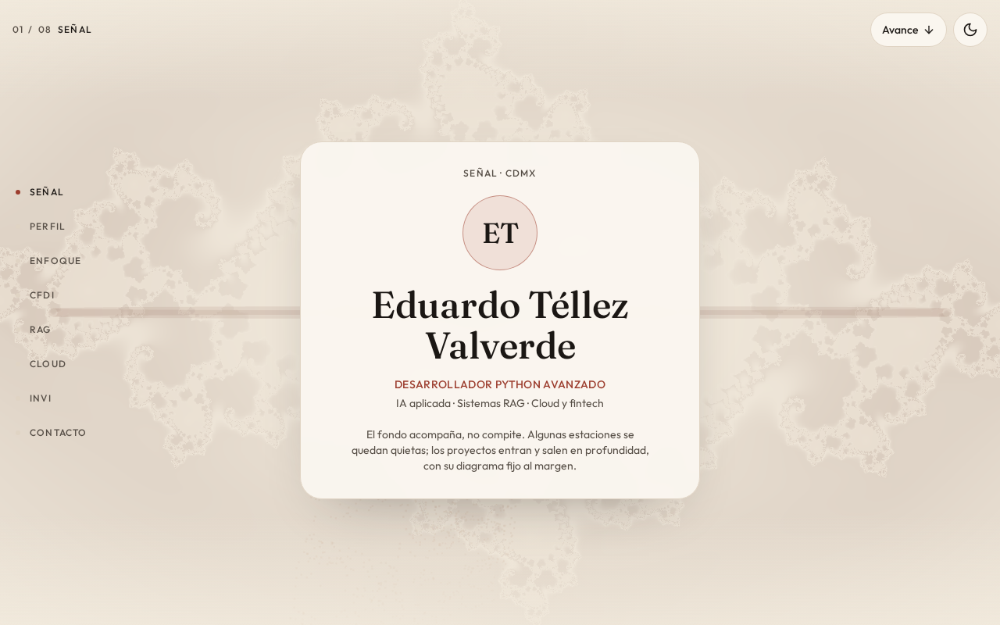
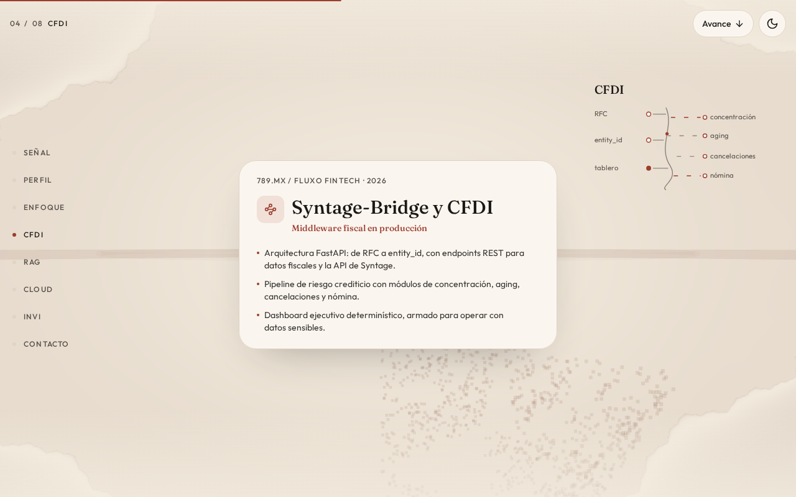
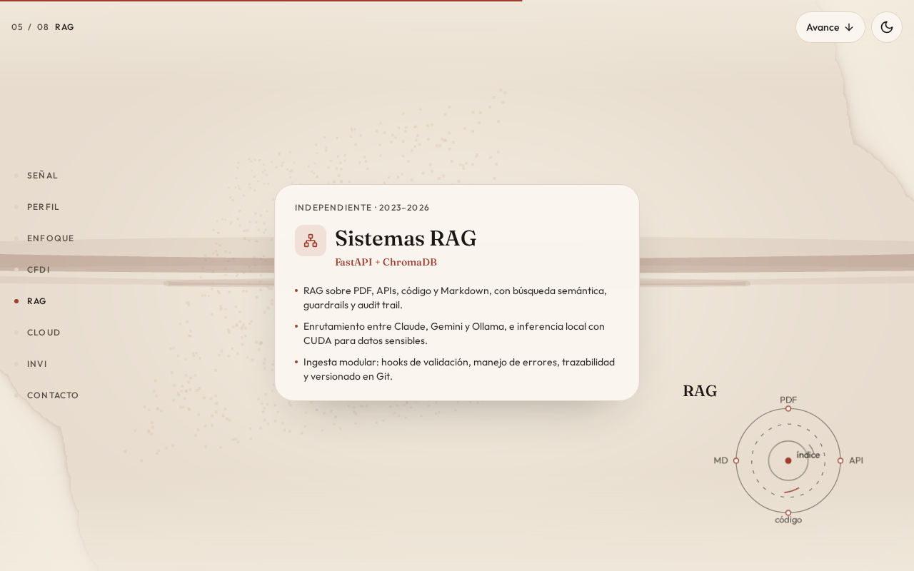

# Eduardo Téllez Valverde — Portafolio de Ingeniería & Sistemas



Portafolio interactivo de **Eduardo Téllez Valverde** — Desarrollador Python avanzado especializado en **IA aplicada, Sistemas RAG, pipelines fiscales CFDI/SAT y arquitecturas de nube híbrida e inferencia local**.

El sitio presenta los ejes técnicos y casos de arquitectura en producción mediante una interfaz de estaciones en profundidad 3D, un motor WebGL con shaders GLSL de conjuntos de Julia en tiempo real y diagramas vectoriales animados para cada sistema.

## Proyectos Destacados en el Portafolio

| Sistema                              | Entorno / Periodo               | Arquitectura y Alcance Técnico                                                                                                                                                                                             |
| :----------------------------------- | :------------------------------ | :------------------------------------------------------------------------------------------------------------------------------------------------------------------------------------------------------------------------- |
| **Syntage-Bridge y CFDI**            | 789.mx / Fluxo Fintech (2026)   | Middleware fiscal en producción con **FastAPI** (resolución de `RFC` a `entity_id`, endpoints REST sobre la API de Syntage) y pipeline determinístico de riesgo crediticio (concentración, aging, cancelaciones y nómina). |
| **Sistemas RAG**                     | Independiente (2023–2026)       | Búsqueda semántica con **FastAPI + ChromaDB** sobre PDF, APIs, código y Markdown; enrutamiento híbrido entre Claude, Gemini y **Ollama (CUDA local)** con guardrails, hooks de validación y _audit trail_.                 |
| **Cloud Híbrido e Inferencia Local** | Azure AI Foundry · AWS · Ollama | Generación automatizada de reportes ejecutivos con LLM + RAG sobre CFDI en **Azure AI Foundry**, almacenamiento en **Azure Blob Storage** y **AWS S3**, e inferencia local con **Ollama + CUDA** para datos sensibles.     |
| **INVI · OCR y Geodatos**            | Vivienda CDMX (2021–2023)       | Automatización institucional de expedientes físicos mediante **OCR**, pipelines geoespaciales (**KML, GeoJSON, CSV, XLSX**) y conciliación con validación por etapas y _fuzzy matching_.                                   |

## Vista de Estaciones Interactivas

|                 Syntage-Bridge y CFDI                  |               Sistemas RAG                |
| :----------------------------------------------------: | :---------------------------------------: |
|  |  |

## Stack Tecnológico del Sitio

- **Framework & Enrutamiento:** [React 19](https://react.dev/) + [TanStack Start / Router](https://tanstack.com/router) con SSR y pre-carga tipada.
- **Gráficos 3D & Shaders:** [Three.js](https://threejs.org/) con un fragment shader **GLSL** personalizado (interpolación continua sobre el conjunto de Julia, nubes de puntos tetraédricas y anillos orbitales reactivos al scroll y puntero).
- **Motor de Profundidad & Accesibilidad:** Hook personalizado (`useDepthMotion`) con interpolación `requestAnimationFrame`, navegación por teclado (`ArrowUp`/`ArrowDown`/`PageUp`/`PageDown`), soporte completo para `prefers-reduced-motion` y tema claro/oscuro persistente.
- **Estilos & Tipografía:** [Tailwind CSS v4](https://tailwindcss.com/) con variables CSS en espacio de color `oklab`, tipografía editorial _Fraunces_ y _Outfit_, y diagramas de arquitectura en SVG animado.
- **Despliegue:** Preconfigurado con [Nitro](https://nitro.build/) para despliegue directo en [Vercel](https://vercel.com/).

## Registro de Visitantes del CV (Cloudflare Worker + D1)

El formulario "Abrir currículum" registra quién solicita ver el CV mediante un
Cloudflare Worker (`cv-visitors-api`) que persiste en una base D1 (`cv-visitors`).
El frontend (`src/components/cv-access-dialog.tsx`) hace `POST` a `/api/cv-visitors`.

Arquitectura, esquema, migraciones y despliegue en
[`docs/cv-visitor-tracking.md`](docs/cv-visitor-tracking.md).

## Estructura del Proyecto

```text
├── docs/
│   ├── cv-visitor-tracking.md      # Registro de visitantes del CV (Worker + D1)
│   └── screenshots/                # Capturas de las estaciones del portafolio
├── public/
│   ├── cv-eduardo-tellez-valverde.pdf
│   ├── favicon.svg
│   └── og.jpg                      # Tarjeta OpenGraph para redes sociales
├── src/
│   ├── components/
│   │   ├── bio-page.tsx            # Layout principal y estaciones del portafolio
│   │   ├── cv-access-dialog.tsx    # Modal de acceso y registro del CV
│   │   ├── fractal-canvas.tsx      # Lienzo WebGL con carga diferida en cliente
│   │   ├── motion-state.ts         # Estado compartido de scroll y puntero
│   │   ├── mount-fractal.ts        # Escena Three.js y shaders GLSL (Julia set)
│   │   ├── project-diagrams.tsx    # Diagramas SVG animados por proyecto
│   │   └── use-depth-motion.ts     # Motor 3D de transición entre estaciones
│   ├── data/
│   │   └── profile.ts              # Datos de perfil, ejes técnicos y proyectos
│   ├── lib/
│   │   └── error-component.tsx     # Componente de captura de errores
│   ├── routes/
│   │   ├── __root.tsx              # Documento raíz, metadatos SEO/OG y tema
│   │   └── index.tsx               # Ruta principal (/)
│   ├── router.tsx                  # Configuración de TanStack Router
│   └── styles.css                  # Tokens de diseño, tema claro/oscuro y animaciones
├── worker/
│   ├── migrations/                 # Migraciones de D1 (esquema de cv_visitors)
│   ├── src/index.ts                # Worker cv-visitors-api (POST /api/cv-visitors)
│   └── wrangler.toml               # Configuración del Worker y binding de D1
├── package.json
├── tsconfig.json
├── vercel.json
└── vite.config.ts
```

## Instalación y Desarrollo Local

### Prerrequisitos

- **Node.js** 20+ (recomendado 22 LTS)
- **npm** 10+

### Pasos

1. Clonar el repositorio e instalar dependencias:

```bash
git clone https://github.com/Eddglitch/portafolio-eduardo-tellez.git
cd portafolio-eduardo-tellez
npm install
```

2. Iniciar el servidor de desarrollo (disponible en `http://localhost:3000`):

```bash
npm run dev
```

3. Verificar tipos y generar el build de producción:

```bash
npm run typecheck
npm run build
npm run preview
```

## Contacto

- **Nombre:** Eduardo Téllez Valverde
- **Ubicación:** Estado de México / CDMX
- **GitHub:** [@Eddglitch](https://github.com/Eddglitch)
- **LinkedIn:** [linkedin.com/in/eduardo-telv](https://www.linkedin.com/in/eduardo-telv)
- **Correo:** [eduardotelv@gmail.com](mailto:eduardotelv@gmail.com)

## Licencia

Distribuido bajo la licencia [MIT](LICENSE).
